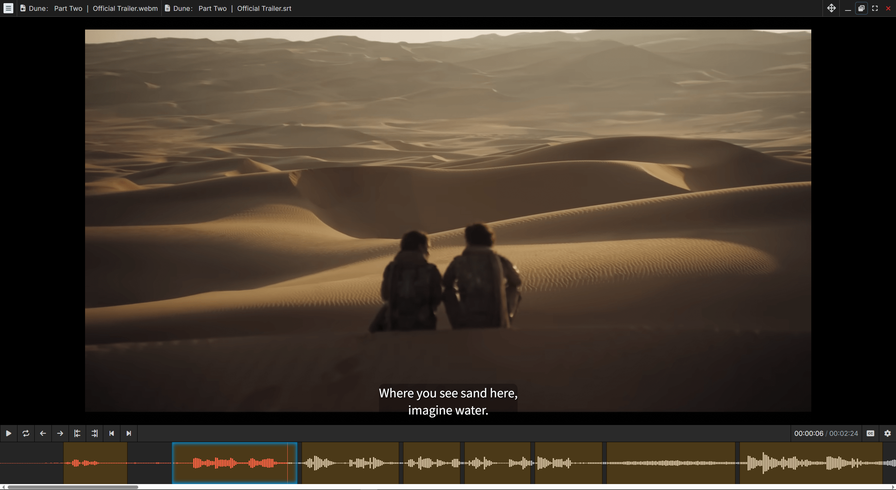

# Y'ALL Media Player

<div align="center" style="font-size: 2rem;">
  
  <br>
  <b style="color: #2563EB;">Y</b>et
  <b style="color: #2563EB;">A</b>nother
  <b style="color: #2563EB;">L</b>anguage
  <b style="color: #2563EB;">L</b>earning
  <br>
  <b style="color: #2563EB;">M</b>edia
  <b style="color: #2563EB;">P</b>layer
  <br><br>
</div>

**Y'ALL MP** is not just a media player; it is a comprehensive tool designed to bridge the gap between passive listening and active learning.
It combines high-performance media playback with advanced tools to edit subtitle text and adjust timing, provides instant dictionary lookups, and seamless **Anki** flashcards creation.

<div align="center">
  
  <p style="margin-top: 0;"><em>Image source: "Dune: Part Two - Official Trailer" (Warner Bros. Pictures)</em></p>
</div>

Whether you are sentence mining, training listening comprehension, or practicing shadowing, **Y'ALL MP** provides the granular control and automation you need.

---

### Official Website & Download
Get the latest installer for Windows, Linux, and macOS at the official website:
**[Y'ALL Media Player - Free Language Learning Media Player](https://yallmp.com)**

Alternatively, view the [GitHub release list](https://github.com/kgurniak91/yall-mp/releases).

---

## ⚠️ Platform Status: Experimental Beta

**Y'ALL MP is primarily developed and optimized for Windows.**

The video is rendered by libmpv into a canvas inside the single application window, so subtitles, the timeline and dialogs stack the same way on every platform. By default the picture reaches the window straight from the graphics card on every platform (Direct3D 11 on Windows, IOSurface on macOS, dma-buf on Linux). If that does not work on a machine, the player switches to copying the frames through the CPU by itself (see [Video output](#video-output) below).

| Platform    | Status                   | Notes                                                                                                                                                                                                                              |
|:------------|:-------------------------|:-----------------------------------------------------------------------------------------------------------------------------------------------------------------------------------------------------------------------------------|
| **Windows** | ✅&nbsp;**Stable**        | Fully supported. Recommended experience.                                                                                                                                                                                           |
| **Linux**   | 🧪&nbsp;**Experimental** | Needs libmpv and audiowaveform (see below); Ubuntu 24.04's own libmpv works. Tested on real hardware: Ubuntu 24.04 (GNOME, X11 and Wayland) with AMD Radeon graphics (Mesa). Earlier also in virtual machines: Lubuntu (LXQt) and Fedora 44 (KDE). NVIDIA and Intel graphics are not tested yet. |
| **macOS**   | 🧪&nbsp;**Experimental** | Needs Homebrew `mpv` and `audiowaveform` (see below). Tested on a Mac mini M2 (Apple Silicon, macOS 27). The app is not notarized by Apple, so macOS asks once before the first start (see installation instructions).            |

### 🤝 Call for Contributors

**Y'ALL MP** is developed and tested primarily on Windows.
macOS and Linux are now tested on real hardware as well, but only on one Mac (Apple M2) and one Linux PC (AMD graphics). Reports from other setups are very welcome, especially Linux with NVIDIA or Intel graphics, other distributions and desktops, and other Macs.
Please attach `video.log` from the app data folder and name your GPU, driver and, on Linux, the session (X11 or Wayland). NVIDIA's proprietary driver needs `nvidia-drm.modeset=1` for the GPU video path; Electron currently has an open bug with dma-buf frames on some NVIDIA setups (electron/electron#53271), so expect that to be the hardest case.
**Contributions to improve cross-platform support are greatly appreciated!**

<a id="video-output"></a>
#### Video output

**Global Settings > General > Playback Settings > Fast video path (GPU)** decides how the finished picture gets from the graphics card to the player window:

*   **ON (default, recommended):** the graphics card hands the picture straight to the window. It uses very little CPU, so even high-resolution or 60 fps videos stay smooth. If it does not work on your computer (no usable GPU, a black picture, a GPU reset), the player notices and switches to the safe way by itself; `video.log` says why.
*   **OFF (safe mode):** every picture is copied through the CPU first. Works almost everywhere, but uses a lot more CPU and can stutter on big videos or slow computers.

Try **OFF** if the app crashes or freezes while a video plays, or if the picture is black, flickers or has odd colours. The change applies the next time you open a project. If OFF fixes it, please report the problem together with your graphics card.

**Hardware Acceleration** (the switch above it) is a separate setting: it decides whether the graphics card *decodes* the video, not how the picture reaches the window.

#### Reporting problems

If the app crashes, please attach what it left in the app data folder: `video.log` (the video backend and why) and the minidumps in the `Crashpad` subfolder (`reports` on Windows, `completed` elsewhere). Dumps stay on your machine; nothing is uploaded unless you send it. If the playback engine stops by itself the player restarts it at the same position once, and says so in a message.

---

## ✨ Key Features

### ✂️ Fully Interactive Timeline
*   **Visual Editing:** Your subtitles are not perfect? Not a problem! Adjust subtitle timings instantly by dragging clip edges on the timeline.
*   **On-the-Fly Corrections:** Fix typos or rewrite subtitle text entirely, directly within the player, without leaving the flow.
*   **Clip Management:** Split long sentences, merge broken lines or even add own subtitles.

### 📺 Professional Playback
*   **Powered by [mpv](https://mpv.io/) (libmpv):** Plays virtually any media format (MKV, MP4, WEBM, etc.) with hardware acceleration.
*   **Audio Waveform:** Visualize dialogue rhythm and silence with a high-precision timeline generated by [audiowaveform](https://github.com/bbc/audiowaveform).
*   **Context-aware Speed Control:** Automatically speed up silence or slow down difficult dialogue segments independently.
*   **Study Presets:** Switch instantly between **Listening Mode** and **Speaking Mode** to target specific skills, depending of your study goals.

### 💬 Advanced Subtitles
*   **Interactive Rendering:** Full support for complex interactive **ASS/SSA** subtitles with proper font attachment loading.
*   **Offline Dictionaries:** Zero-latency, hover-based dictionary lookups powered by the bundled **[Yomitan](https://github.com/yomidevs/yomitan)** extension.
*   **Online Lookup:** One-click search via built-in browser integration for deeper context (Google, Brave, Forvo, etc.).
*   **Smart Tokenization:** Advanced word boundary detection (using standard `Intl.Segmenter` or dictionary-based scanning) allows precise selection of words or phrases.
*   **Multi-Track Support:** Seamless switching between multiple parallel subtitle and audio tracks.

### 🧠 Sentence Mining & [Anki](https://apps.ankiweb.net/)
*   **One-Click Export:** Instantly create Anki cards containing the subtitle text, audio clip, and a video snapshot.
*   **Multiple Templates Support:** Configure multiple templates to map media data (text, audio, image, video) to your specific Anki note types, then export them all at once.
*   **Duplicate Prevention:** Automatically tracks export history to show which subtitled clips have already been exported.

---

<a id="system-requirements"></a>
## ⚙️ System Requirements

Depending on your operating system, you may need to install external dependencies for the **Y'ALL MP** to work.

### 🗔 Windows
**No additional actions required.** The installer comes pre-packaged with all necessary binaries (`libmpv`, `audiowaveform`, `ffmpeg` etc.), enjoy!

### 🐧 Linux

The Linux release comes as an `.AppImage` (any distribution) and as a `.deb` package (Debian, Ubuntu and derivatives). Both use libmpv and audiowaveform from your system.

1. **Install libmpv** (the playback library behind mpv: `libmpv2` on Debian/Ubuntu, `mpv-libs` on Fedora). On Ubuntu 24.04 the distribution's own package works (libmpv 0.37):

    ```bash
    sudo apt install libmpv2
    ```

    Other systems: see the official instructions at [https://mpv.io/installation/](https://mpv.io/installation/)

> **💡 Recommended:** libmpv 0.40 or newer. The app is tested with Ubuntu 24.04's own libmpv 0.37 and with libmpv 0.42 from the PPA below. If playback misbehaves on an older libmpv, or your distribution has no `libmpv2` package at all (Ubuntu 22.04 and older), install a current one from the PPA:
>
> ```bash
> sudo add-apt-repository ppa:ubuntuhandbook1/mpv
> sudo apt update
> sudo apt install mpv libmpv2
> ```
>
> Check with `mpv --version` that the version is 0.40 or higher.

2. **Install audiowaveform:**
    [https://github.com/bbc/audiowaveform/releases](https://github.com/bbc/audiowaveform/releases)

```bash
sudo add-apt-repository ppa:chris-needham/ppa
sudo apt-get update
sudo apt-get install audiowaveform
```

3. **Install the app**, either way:

    **`.deb` package** (recommended on Debian/Ubuntu): apt installs the other dependencies and adds the app to your applications menu.

    ```bash
    sudo apt install ./yall-mp_*.deb
    ```

    **AppImage:** make the file executable (in its Properties, or with `chmod`), then double-click it or start it from a terminal:

    ```bash
    chmod +x ./<filename>.AppImage
    ./<filename>.AppImage
    ```

    Starting an AppImage directly needs FUSE 2: `sudo apt install libfuse2t64` on Ubuntu 24.04 (`libfuse2` on 22.04 and older). Without it, `./<filename>.AppImage --appimage-extract-and-run` works too. If the app does not start on your system, try it from a terminal with `--no-sandbox` added after the file name.
    On its first start the AppImage adds itself to your applications menu (`~/.local/share/applications/yall-mp.desktop` and an icon in `~/.local/share/icons/hicolor/512x512/apps/yall-mp.png`); from then on you can start it from there. To remove the entry, delete those two files.

> **🖥️ X11 and Wayland:** the app runs through X11, which on a Wayland desktop means XWayland (every mainstream distribution ships it). The packaged `yall-mp` is a small launcher script that starts the real program with `--ozone-platform=x11`. The reason: a native Wayland window cannot find out where it is or on which monitor, which broke fitting the window to a smaller second monitor and made fullscreen show a stretched picture for a moment. Native Wayland is therefore **not supported**, but you can still force it for testing, at your own risk:
>
> ```bash
> yall-mp --ozone-platform=wayland
> ```
>
> (or `Exec=yall-mp --ozone-platform=wayland %U` in a copy of the menu entry; for the AppImage, put the same switch after the file name). A Wayland-only system without XWayland starts natively and has those problems. With fractional scaling (for example 125 % or 150 %) on a Wayland desktop, the window, the video and the subtitles look slightly soft, because the desktop scales XWayland windows up.

### 🍎 macOS

The macOS release is built for Apple Silicon (M1 and newer).

1. **Install mpv** with [Homebrew](https://brew.sh/) (this provides libmpv, which the app loads at runtime; the app finds Homebrew's libmpv also when started from Finder):
   See official instructions: [https://mpv.io/installation/](https://mpv.io/installation/)

```bash
brew install mpv
```

2. **Install audiowaveform:**
   [https://github.com/bbc/audiowaveform/releases](https://github.com/bbc/audiowaveform/releases)

```bash
brew tap bbc/audiowaveform
brew install audiowaveform
```

---

<a id="installation"></a>
## 📥 Installation & Usage

### Download
Visit the [main page](https://yallmp.com) or [release list](https://github.com/kgurniak91/yall-mp/releases) to get the **Y'ALL MP** installer for your platform (`.exe`, `.AppImage`, or `.dmg`).

### macOS Users (Important)
The app is signed only ad hoc and not notarized by Apple (that needs a paid Apple Developer account), so macOS asks once before the first start:

1.  Open the `.dmg` and drag **Y'ALL Media Player** into your **Applications** folder.
2.  Start the app. macOS says it cannot verify the developer: click **Done** (not Move to Trash).
3.  Open **System Settings > Privacy & Security**, scroll down to the message about Y'ALL Media Player, click **Open Anyway** and confirm.

After that it opens normally.
Alternatively, remove the quarantine attribute in **Terminal** before the first start: `xattr -cr "/Applications/Y'ALL Media Player.app"`

On a Mac, the shortcuts that use **Ctrl** on Windows use **Command** (⌘) instead; the list of shortcuts in the app (⌘/, or F1 with fn held) shows the right keys.

---

## 💻 Development

### Prerequisites
*   **Node.js** (v22+ recommended)
*   **npm**
*   **System Dependencies:** Ensure you have installed the requirements listed in the [System Requirements](#system-requirements) section above.
*   **Native addon** (the libmpv binding, see [`native/yall-libmpv`](native/yall-libmpv/README.md)):
    *   **Windows:** Visual Studio 2019 (16.11+) or 2022 Build Tools with "Desktop development with C++" (MSVC v142 or newer), the Windows 10 SDK and CMake 3.20+ (the CMake bundled with Visual Studio is found automatically).
    *   **macOS:** Xcode Command Line Tools, `brew install mpv cmake`.
    *   **Linux:** `build-essential`, `cmake`, `gdb`, `rsync`, `xz-utils`, libmpv with Lua (`libmpv2` / `libmpv-dev`, from the mpv PPA on Ubuntu), `libegl-dev` and `libgbm-dev` (without them the host is built without the GPU (dma-buf) video path), and `libfuse2t64` to start a built AppImage directly.
    *   **Fedora:** `sudo dnf install gcc-c++ cmake libstdc++-static mpv-libs-devel`, and for H.264 playback the full ffmpeg from RPM Fusion (`sudo dnf swap ffmpeg-free ffmpeg --allowerasing`, `sudo dnf install libavcodec-freeworld`). `audiowaveform` is not packaged for Fedora and has to be built from https://github.com/bbc/audiowaveform.
    *   Build with `npm run native:build`, run the integration tests with `npm run test:native` and the Electron smoke harness with `npm run test:native:smoke`.

### Setup

1.  **Clone the repository:**
    ```bash
    git clone https://github.com/kgurniak91/yall-mp.git
    cd yall-mp
    ```

2.  **Install dependencies:**
    This will also download Windows-specific binaries (libmpv, audiowaveform) and the Yomitan extension via the `postinstall` script.
    ```bash
    npm install
    ```

3.  **Build the native addon** (once after cloning, and after changes in `native/`):
    ```bash
    npm run native:build
    ```

### Running the App

To run in development mode with hot-reloading (Angular + Electron):

1.  **Start the build watcher:**
    ```bash
    npm run electron:watch:build
    ```
    *Wait until the initial build completes.*

2.  **Launch the Electron shell (in a new terminal):**

    On Windows:

    ```bash
    npm run electron:watch:run
    ```

    On Linux (a development run is not started through the X11 launcher script, so add the switch by hand):

    ```bash
    npm run electron:watch:run -- --no-sandbox --ozone-platform=x11
    ```

### Testing

*   **Angular Tests (Karma):** `npm run test:angular`
*   **Electron Tests (Vitest):** `npm run test:electron`
*   **Run All:** `npm run test:all`
*   **Native addon (Vitest, real libmpv):** `npm run test:native`; `npm run test:native:smoke` plays a file on one video backend and prints a summary.

#### End-to-end tests (Playwright)

*   `npm run test:e2e` builds the app and runs the suite. `npm run test:e2e:run` runs it without rebuilding, so build first (`npm run electron:build`) if the sources changed.
*   The tests launch the real app, so close any running Y'ALL MP instance first. Test data goes to a throwaway userData directory, so your real projects are never touched.
*   The `@os-input` spec moves the **real mouse** (window drag, snapping and edge resize; Windows, and Linux X11 with `xdotool`). Keep your hands off the machine while it runs, or skip it with `npx playwright test --grep-invert @os-input`.
*   Test media is generated by `npm run e2e:fixtures` and committed in `test/e2e/fixtures/`.
*   Environment variables: `YALL_MP_E2E=1` (disables DevTools, exposes a window probe and test hooks), `YALL_MP_USER_DATA_DIR` (overrides the userData directory), `E2E_RECORD_DESKTOP=1` (records the desktop with ffmpeg to `e2e-artifacts/`).
*   Video path (diagnostics, CI): `YALL_MP_VIDEO_BACKEND=auto|readback|d3d11-shared|iosurface-shared|dmabuf-shared` picks how frames reach the page (the default `auto` tries the platform's GPU shared-texture path first and falls back to readback), `YALL_MP_VIDEO_ADAPTER=warp|default` forces the software or the default D3D11 adapter (`warp` is what a GPU-less CI runner uses). The chosen backend and adapter are logged when a project opens.
*   Hosted CI runners have no GPU, so the pixel probes, real mouse input and Windows screen capture are only reliable on a local machine with a GPU.

## 📦 Building the Application

To create a distributable installer/executable for your current OS:

*   **Windows:** `npm run package:win`
*   **Linux:** `npm run package:linux`
*   **macOS:** `npm run package:mac`

The output files will be located in the `dist_electron` folder.

---

## 🛠️ Tech Stack

**Core Application**
*   **[Electron 44](https://www.electronjs.org/):** Cross-platform desktop framework.
*   **[Angular 19](https://angular.io/):** Frontend framework with **Signals** for reactive state management.
*   **[PrimeNG 19](https://primeng.org/):** UI Component library.

**Media & Processing**
*   **[libmpv](https://mpv.io/):** The mpv player as a library, driven through a native Node addon (`native/yall-libmpv`); its frames are drawn into the app window.
*   **[Audiowaveform](https://github.com/bbc/audiowaveform):** C++ program used to generate waveform JSON data from audio streams.
*   **[FFmpeg Static](https://www.npmjs.com/package/ffmpeg-static):** Bundled FFmpeg binary for extracting audio/video clips for Anki export.

**Subtitles & Text**
*   **[ASS-Compiler](https://github.com/weizhenye/ass-compiler):** Parses and compiles ASS subtitle formats.
*   **[ASS.js](https://github.com/weizhenye/ASS):** Renders interactive ASS subtitles on HTML5 canvas.
*   **[Yomitan](https://github.com/yomidevs/yomitan):** Bundled browser extension for offline dictionary lookups.
*   **[Wavesurfer.js](https://wavesurfer-js.org/):** Renders the audio waveform timeline.
*   **[Franc](https://github.com/wooorm/franc):** Language detection for selecting the correct tokenizer.
*   **[Font-Scanner](https://github.com/axosoft/font-scanner):** Locates system fonts to properly render styled subtitles.

---

## 📄 License

This project is licensed under the **GNU General Public License v3.0 (GPLv3)**.

You are free to use, modify, and distribute this software. If you distribute modified copies, they must also be released under the GPLv3. See the [LICENSE](LICENSE) file for details.
